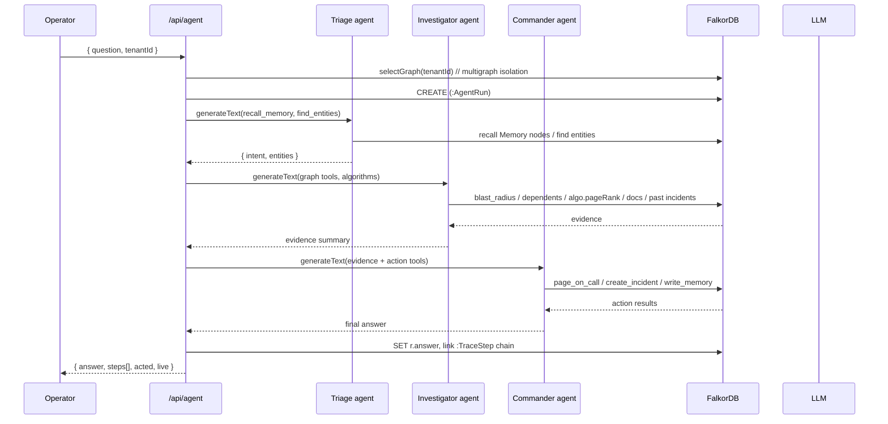

# Architecture — how Unspool works

## The core idea

Most "agent + graph" demos treat the graph as a read-only knowledge base the agent
queries once. Unspool inverts that: **the graph is the agent's working memory and
its paper trail**. Every step the agent takes — a Cypher query, a PageRank run, a
memory recall, a decision, an action — is written *back into FalkorDB* as nodes
and edges while it happens. The UI then replays that trace on the live graph.

This makes three hard properties fall out for free:

1. **Explainability** — provenance is queryable graph data, not a log file.
2. **Cross-session memory** — memory is a node with `kind` and `ABOUT` edges.
3. **Multi-agent state** — specialists share state by writing to the same graph.

## Request flow

## The three specialists

| Stage | System prompt role | Tools | Stop condition |
|---|---|---|---|
| **Triage** | Classify intent, recall memory, scope entities | `recall_memory`, `find_entities` | 4 steps |
| **Investigator** | Gather graph evidence exhaustively | all read tools + `run_algorithm` | 8 steps |
| **Commander** | Decide, act, remember, answer | action tools + `write_memory` | 6 steps |

Each stage is a separate `generateText` call with its own system prompt and tool
set. Stages don't pass state through memory — they pass it through the **graph**:
the investigator's `:TraceStep` nodes (with their `[:TOUCHES]` links) *are* the
evidence the commander reasons over. The UI renders the same chain.

## Why FalkorDB specifically

- **Multigraph topology** — one instance holds thousands of isolated graphs. Each
  tenant (`demo`, `acme`, `globex`) gets `unspool_<tenant>` with its own memory and
  state. No per-tenant deployments. This is the Track-02 "separate memory per
  user or tenant" requirement, satisfied by the database's core topology.
- **Cypher with graph algorithms** — `algo.pageRank`, `algo.WCC`, `algo.CDLP`,
  `algo.betweennessCentrality` run in the same engine as the traversals, so the
  agent can call them as tools without a second system.
- **Traversals fast enough for the agent loop** — sparse-matrix (GraphBLAS) storage
  keeps multi-hop `DEPENDS_ON*1..3` walks in single-digit milliseconds, so the agent
  can afford to walk the graph on every step.

## The tool registry (single source of truth)

`src/lib/agent/registry.ts` defines each tool once: name, description, zod schema,
handler. Two adapters consume it:

- `tools.ts` → AI SDK `tool()` for the in-process agent.
- `mcp.ts` → MCP `registerTool()` for any external MCP client.

So "tool selection through MCP" is literal: the same definitions serve both paths,
and an external agent driving Unspool over MCP produces the same trace in the same
graph.

## Failure modes & fallbacks

- **No LLM key** → deterministic *graph-replay* pipeline: real Cypher, real
  PageRank, real memory/action writes, canned narrative. Labeled in the UI.
- **FalkorDB unreachable** → `/api/health` reports it; API routes return 503 with
  a setup hint; the UI shows the badge.
- **LLM stage fails** → the stage is skipped and the next one proceeds with whatever
  evidence exists; the failure is recorded as a trace step.

## Performance notes

- One FalkorDB connection per warm serverless process (lazy singleton).
- All agent Cypher is parameterized (`$param`) — no string concatenation of user
  input, so prompt injection can't become Cypher injection.
- Canvas subgraphs are capped (120 nodes / 400 edges) and laid out
  deterministically (BFS depth from the seed) so the UI doesn't jitter.
